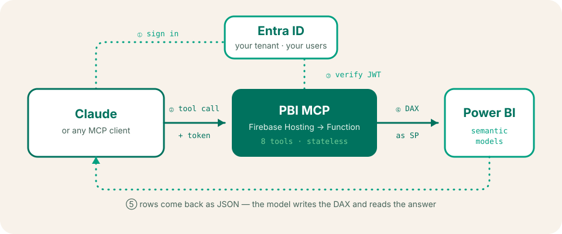
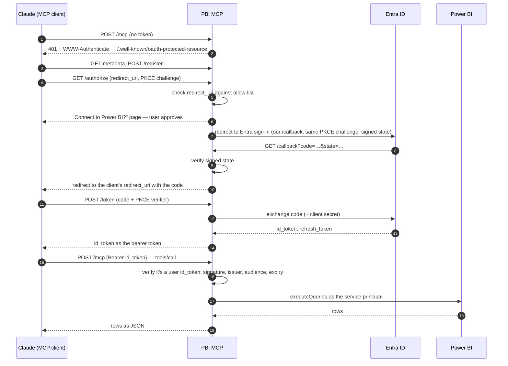

<div align="center">

<picture>
  <source media="(prefers-color-scheme: dark)" srcset="https://raw.githubusercontent.com/The-Bunch/.github/main/profile/assets/hellobill-logo-inverse.svg">
  
</picture>

### Your numbers, sorted.

**PBI MCP** is a remote MCP server for Power BI. Ask Claude a question in plain English<br>
and it explores your datasets, writes the DAX and reads you the answer — signed in with<br>
your Microsoft account and running on Firebase in about fifteen minutes.


[hellobill.com](https://hellobill.com) · [Deploy it](#deploy-to-firebase) · [How it works](#how-it-works) · [Sibling repos](https://github.com/The-Bunch)



</div>

## Why this exists

At [helloBill](https://hellobill.com) we set up people's whole home — energy, water,
council tax, broadband — and every one of those journeys leaves numbers behind. Ours
end up in a dbt warehouse, published to Power BI. Power BI is great at dashboards. It
is less great at the question nobody built a dashboard for, asked at 7:40 on a
Monday morning.

So, as part of our data quest — the R&D work on getting every number we have one
question away from whoever needs it — we wanted Claude to talk to Power BI directly.
We went looking for a Power BI MCP server that was **remote** (works in claude.ai, on
your phone, for the whole team, not just one laptop), **signed in** (your company
identity, not a shared key in a config file) and **boring to run** (scale to zero, no
servers to patch). We couldn't find one. So we built it, and it stuck.

It's not our product — just a tool from the journey, released in case it's useful to
you too.

## What it does

Eight tools, enough for a model to find its own way from "what have we got?" to an
answer:

| Tool | What it does |
| --- | --- |
| `pbi_list_workspaces` | Lists the workspaces the server can see — the model's starting point |
| `pbi_list_datasets` | Lists the datasets (semantic models) in a workspace |
| `pbi_list_reports` | Lists the reports in a workspace and the dataset behind each |
| `pbi_list_tables` | Every table and column in a dataset, so the DAX uses real names |
| `pbi_execute_dax` | Runs a DAX query and returns the rows as JSON |
| `pbi_refresh_history` | Recent refreshes: status, timings, errors |
| `pbi_ensure_fresh` | Refreshed today? Fine. Not yet? Triggers a refresh (unless one's already running) |
| `pbi_refresh_dataset` | Triggers a refresh outright |

The two refresh-triggering tools can be switched off with `PBI_READ_ONLY=true`.

### What that feels like

> **You:** How did new sign-ups last week compare with the week before, by channel?
>
> **Claude:** *`pbi_list_workspaces` → `pbi_list_datasets` → `pbi_ensure_fresh` →
> `pbi_list_tables` → `pbi_execute_dax`*
>
> Sign-ups were up 12% week on week (1,284 vs 1,146). Nearly all of the growth came
> from partner referrals (+141); organic search was flat and paid social dipped
> slightly. The dataset last refreshed at 06:12 UTC today, so this includes
> yesterday.

*(Illustrative — your numbers, tables and model will differ.)*

Nobody wrote a report for that question. The model found the dataset, checked it was
fresh, read the schema, wrote a `SUMMARIZECOLUMNS` and explained what came back.

## How it works

PBI MCP is one small Express app inside one Firebase Cloud Function, sitting behind
Firebase Hosting so it gets a clean `https://<project>.web.app` address. A few ideas
make it work:

**1. Two identities, two jobs.** *People* sign in with Microsoft Entra ID, which proves
who is asking. The *server* talks to Power BI as a service principal, which decides
what data is reachable. You control the second by adding the service principal only to
the workspaces you want exposed. Everyone who can sign in sees what the service
principal sees — see [Security model](#security-model) for what that means.

**2. An OAuth relay in front of Entra ID.** MCP clients expect a server to publish OAuth
metadata, accept dynamic client registration and run authorization code + PKCE. Entra
ID can't do dynamic registration and only accepts pre-registered redirect URIs. So PBI
MCP speaks MCP-flavoured OAuth on the outside and relays to a single Entra app
registration on the inside, carrying the client's own redirect in a signed `state`.



**3. The id_token is the key.** The access token Entra hands back is meant for Microsoft
Graph, which this server can't validate. The id_token is issued for *our* app
registration, signed by Microsoft, and lives for about an hour — exactly what a resource server
needs to check. So that's what the client presents.

**4. Schema discovery without XMLA.** `pbi_list_tables` runs
`EVALUATE COLUMNSTATISTICS()` through the ordinary `executeQueries` REST API, so the
model can learn every table and column without the XMLA endpoint or Premium-only
tooling. Power BI's auto-generated date tables are filtered out of the noise.

**5. Stateless and scale-to-zero.** Each request builds a fresh MCP server and
Streamable HTTP transport, with no session state to lose between Cloud Function
instances. Idle, it costs nothing.

### Project layout

```
functions/src/
├── index.ts        the Cloud Function: region, secrets, memory
├── app.ts          Express wiring: OAuth routes, auth gate, MCP endpoint
├── oauth.ts        metadata, /register, /authorize, /callback, /token
├── consent.ts      the "Connect to Power BI?" page
├── middleware.ts   bearer-token verification against your tenant's keys
├── security.ts     redirect allow-list, signed state, id_token check, email-domain gate
├── server.ts       the eight MCP tools
├── client.ts       Power BI REST calls
├── auth.ts         service-principal token (cached, single-flight)
└── config.ts       every setting, read from the environment
```

## Security model

PBI MCP puts real business data one sentence away, so it's worth knowing exactly what
stands in the way.

| Control | What it does |
| --- | --- |
| Entra ID sign-in | Only identities in **your** tenant (including B2B guests) can sign in. Every request's token is checked against Microsoft's published keys: signature (RS256 only), v2 issuer, audience, expiry and tenant |
| User id_tokens only | Other apps in your tenant can mint *access* tokens addressed to this app. The server refuses them: it accepts only a v2 user id_token, recognised by its claims |
| Assignment required | Set on the Enterprise Application (a required step below), so only the users and groups you assign can sign in at all |
| `ALLOWED_EMAIL_DOMAINS` | Optional second gate on the signed-in account's domain |
| Redirect allow-list | Codes are only ever sent back to Claude's callbacks or loopback addresses, unless you configure others |
| Signed, expiring state | The client's redirect target travels through Entra in an HMAC-signed `state` that expires after ten minutes, so it can't be swapped in transit |
| PKCE (S256) required | A stolen authorization code is useless without the client's verifier |
| Consent page | Before any sign-in, the server shows its own "Connect to Power BI?" page naming where the connection is going. Approval is bound to that browser by a SameSite cookie and the page can't be framed, so a link someone else crafted can't connect your account to their session |
| Visible sign-in | Entra then always shows the account picker (`prompt=select_account`) — nobody is signed in silently |
| Workspace scoping | The service principal only sees workspaces you add it to — that is your data boundary |
| `PBI_READ_ONLY` | Removes the tools that trigger refreshes |
| Quiet logs | Logs record method, path and outcome — never tokens, secrets, request bodies or query results (unless you turn on `DEBUG`) |
| Secret Manager | The client secret never touches the repo or `.env`; it's injected at runtime |
| Cost ceiling | `maxInstances: 10` in `index.ts` caps how far the function can scale, whatever traffic arrives |

What it **doesn't** do: Power BI permissions are not per-user. Every signed-in person
sees what the service principal sees, and datasets that rely on **row-level security**
aren't supported for service principals by the Power BI API. Expose only workspaces
that everyone who can sign in is allowed to read. Also remember that whatever a tool
returns goes to the model you're using, so treat it like any other place your data
travels.

The OAuth endpoints are public by necessity and have no rate limiting of their own;
`maxInstances` bounds what abuse can cost you, and Entra ID throttles abusive sign-in
traffic upstream. If you expect hostile traffic, put Cloud Armor or an API gateway in
front.

Found a security issue? Please see [SECURITY.md](SECURITY.md) rather than opening a
public issue.

## Deploy to Firebase

About fifteen minutes, most of it clicking through Microsoft admin screens. You'll need:

- A **Firebase project on the Blaze plan** (pay as you go). Cloud Functions and Secret
  Manager need it; at team scale the bill is usually pennies.
- **Node 22** and the **Firebase CLI** (`npm install -g firebase-tools`, then
  `firebase login`).
- An **Entra ID** role that can register apps (Application Developer or above).
- A **Fabric / Power BI admin**, for one tenant setting.
- A Power BI **workspace** you can manage, holding the datasets you want to query.

Throughout, `your-project-id` is your Firebase project ID and your server's address is
`https://your-project-id.web.app`.

### 1. Create the Firebase project

In the [Firebase console](https://console.firebase.google.com/), create a project (or
pick an existing one) and upgrade it to **Blaze**. You don't need to add an app to it.

### 2. Register an app in Entra ID

In the [Entra admin centre](https://entra.microsoft.com/) → **App registrations** →
**New registration**:

| Setting | Value |
| --- | --- |
| Name | `PBI MCP` (users see this on the sign-in screen) |
| Supported account types | **Accounts in this organizational directory only** (single tenant) |
| Redirect URI | Platform **Web**, `https://your-project-id.web.app/callback` |

Then:

1. From **Overview**, copy the **Application (client) ID** and **Directory (tenant) ID**.
2. **Certificates & secrets** → **New client secret**. Copy the **Value** now — you
   won't see it again. Put its expiry date in a calendar.
3. **API permissions** → **Add a permission** → **Microsoft Graph** → **Delegated
   permissions**: add `openid`, `profile`, `email` and `offline_access` (keep the
   default `User.Read`). Then click **Grant admin consent for <your tenant>** so users
   aren't stopped by a consent prompt. Don't add Power BI permissions; the service
   principal gets its Power BI access from workspace membership instead.
4. **Enterprise applications** → **PBI MCP** → **Properties**: set **Assignment
   required?** to **Yes**. Then under **Users and groups**, add the people or group who
   should have access. Don't skip this: without it, everyone in your tenant —
   guests included — can connect and see everything the service principal sees.

This one registration is both the sign-in app for your users and the service principal
that queries Power BI.

### 3. Let the service principal into Power BI

A **Fabric administrator** opens the [admin portal](https://app.powerbi.com/admin-portal/tenantSettings)
→ **Tenant settings** → **Developer settings** and enables **Service principals can call
Fabric public APIs** (older tenants call it *Allow service principals to use Power BI
APIs*). Best practice is to apply it to a security group and add the app's service
principal to that group. Also check that **Semantic model Execute Queries REST API**
(under **Integration settings**) is enabled.

Then, in each workspace you want to expose: **Manage access** → **Add people or
groups** → search for `PBI MCP` → give it **Contributor**. (Contributor is enough to
query and refresh; use Member only if you need more.)

Tenant settings can take up to 15 minutes to apply.

### 4. Clone and configure

```bash
git clone https://github.com/The-Bunch/pbi-mcp.git
cd pbi-mcp
firebase use --add your-project-id          # writes .firebaserc (gitignored)
cd functions
npm ci
cp .env.example .env
```

Edit `functions/.env` and set at least:

```bash
PUBLIC_URL=https://your-project-id.web.app
```

See [Configuration](#configuration) for the optional settings.

### 5. Store the secrets

Three values go into Google Secret Manager. Each command prompts for its value:

```bash
firebase functions:secrets:set PBI_TENANT_ID       # Directory (tenant) ID
firebase functions:secrets:set PBI_CLIENT_ID       # Application (client) ID
firebase functions:secrets:set PBI_CLIENT_SECRET   # the client secret Value
```

Don't also put these in `.env` — Firebase rejects a deploy where a name is both a
secret and an environment variable.

### 6. Deploy

```bash
npm run deploy        # runs the tests, then: firebase deploy --only functions,hosting
```

The first deploy takes a few minutes while Google enables the APIs it needs. If it
asks whether to grant the function access to the secrets, say yes.

### 7. Check it's alive

```bash
curl https://your-project-id.web.app/healthz
# {"ok":true}

curl https://your-project-id.web.app/.well-known/oauth-protected-resource
# {"resource":"https://your-project-id.web.app", ...}

curl -i -X POST https://your-project-id.web.app/mcp
# HTTP/2 401 ... www-authenticate: Bearer realm=..., resource_metadata=...
```

A `401` with a `www-authenticate` header is the correct answer here: the server is up
and waiting for a signed-in client.

### 8. Connect Claude

**claude.ai and Claude Desktop** — **Settings** → **Connectors** → **Add custom
connector**. Give it a name and the URL `https://your-project-id.web.app/mcp`, then
**Connect**. Approve the "Connect to Power BI?" page, sign in with Microsoft, and the
eight tools appear.
(On Team and Enterprise plans, an owner adds the connector once for the organisation
and members connect their own account.)

**Claude Code**

```bash
claude mcp add --transport http pbi https://your-project-id.web.app/mcp
```

Then run `/mcp` inside Claude Code and choose **Authenticate**.

**MCP Inspector**, for poking at the tools by hand:

```bash
npx @modelcontextprotocol/inspector
```

Choose **Streamable HTTP**, enter the `/mcp` URL and click **Connect**.

Other MCP clients work too, as long as they support Streamable HTTP, OAuth with
PKCE, and a redirect URI on your allow-list.

### Optional extras

**Custom domain.** Firebase console → **Hosting** → **Add custom domain**. Then change
`PUBLIC_URL`, add `https://your.domain/callback` as a redirect URI on the Entra app
registration, and redeploy. The server's OAuth identity changes with its address, so
existing connectors need removing and adding again with the new URL.

**A different region.** Change `region` in `functions/src/index.ts` **and** the
rewrite's `region` in `firebase.json` to match (for example `europe-west2`), then
redeploy. Firebase won't move a function between regions automatically, so delete the
old one with `firebase functions:delete mcp --region us-central1`.

**Rotating the client secret.** Create a new secret in Entra, run
`firebase functions:secrets:set PBI_CLIENT_SECRET`, redeploy, then delete the old
secret in Entra. It's the same app registration, so existing connections carry on
working.

**Logs.** `npm run logs` from `functions/`, or Cloud Logging in the Google Cloud
console.

## Configuration

Secrets live in Secret Manager. Everything else goes in `functions/.env`.

| Name | Where | Required | What it does |
| --- | --- | --- | --- |
| `PBI_TENANT_ID` | secret | yes | Your Entra Directory (tenant) ID |
| `PBI_CLIENT_ID` | secret | yes | The app registration's Application (client) ID |
| `PBI_CLIENT_SECRET` | secret | yes | The app registration's client secret |
| `PUBLIC_URL` | `.env` | yes | The server's public origin, e.g. `https://your-project-id.web.app` |
| `ALLOWED_REDIRECT_URIS` | `.env` | no | Comma-separated redirect URIs MCP clients may use. Defaults to Claude's two callbacks plus `http://localhost` and `http://127.0.0.1` (any port, for desktop clients) |
| `ALLOWED_EMAIL_DOMAINS` | `.env` | no | Comma-separated; only accounts in these domains may connect |
| `PBI_READ_ONLY` | `.env` | no | `true` hides `pbi_refresh_dataset` and `pbi_ensure_fresh` |
| `PBI_DATASET_HINT` | `.env` | no | Extra guidance appended to the query tools' descriptions — see below |
| `DEBUG` | `.env` | no | `true` logs 200-character previews of Power BI responses. Leave off in production |

### Teach it your warehouse

A model given eight tools and a blank page will find its way, but it gets there faster
if you tell it where the good data lives. `PBI_DATASET_HINT` is appended to the
descriptions of `pbi_list_tables` and `pbi_execute_dax`, which every MCP client shows
the model:

```bash
PBI_DATASET_HINT=For current figures use the "Warehouse" dataset (ID 0000…). It refreshes daily at 06:00 UTC. Key tables: fct_orders (one row per order, filter on order_date), dim_customer, dim_channel. Older datasets in the Archive workspace are stale.
```

This was the single biggest improvement in answer quality for us: a few factual
sentences took the model from wandering through every dataset to going straight to the
right table. Keep it short and factual, and keep it free of anything you wouldn't put in
a tool description.

## Troubleshooting

| Symptom | Likely cause |
| --- | --- |
| `pbi_list_workspaces` says the service principal can't see any workspaces | The Fabric tenant setting isn't enabled (or the app isn't in its security group), or the app hasn't been added to a workspace. Allow 15 minutes after changing tenant settings |
| `Power BI API error 401` on a query | The dataset uses row-level security or SSO (not supported for service principals), or the principal's workspace role is too low |
| Entra says `AADSTS50011: redirect URI mismatch` | The Entra redirect URI doesn't exactly match `${PUBLIC_URL}/callback` |
| Entra says `AADSTS50105` / "not assigned to a role" | Assignment required is on and this user isn't assigned to the Enterprise Application. Working as intended |
| Entra says `AADSTS65001` or `AADSTS90094` / "needs admin approval" | Admin consent hasn't been granted. **API permissions** → **Grant admin consent** |
| Browser shows "redirect_uri is not allowed by this server" | Your MCP client uses a callback outside the allow-list. Add it to `ALLOWED_REDIRECT_URIS` |
| "Invalid or expired sign-in state" or "This approval has expired" | The sign-in took longer than ten minutes, was started in a different browser, another connection was started in the meantime, or the link was reused. Connect again |
| Connected yesterday, `401` today | The refresh token expired or was revoked (for example after a password reset or a Conditional Access change). Reconnect the connector |
| Deploy fails on secrets | A secret name is also set in `.env`, or the project isn't on Blaze |
| Big queries time out or are refused | The function allows 60 seconds and returns at most 2 MB per result. Aggregate in DAX (`SUMMARIZECOLUMNS`, `TOPN`) instead of returning whole tables; the Power BI API also caps results at 100,000 rows |

## Development

```bash
cd functions
npm ci
npm test            # build + unit and HTTP tests (no Microsoft account needed)
npm run serve       # Firebase emulators: functions + hosting on localhost
```

The tests run the real Express app with fake credentials and cover the OAuth relay end
to end: metadata, the consent page and its browser binding, the redirect allow-list,
signed state, PKCE enforcement and token rejection — plus the tool list and read-only mode. To exercise tools against a real
tenant locally, put the three secrets in `functions/.secret.local` and `PUBLIC_URL=http://localhost:5002` in
`functions/.env.local` (both gitignored; the emulator loads `.env.local` over `.env`),
and add `http://localhost:5002/callback` as an extra redirect URI on the Entra app
registration. Connect to the Hosting emulator address (port 5002 — not 5000, which
macOS reserves for AirPlay), not the functions emulator URL, and use Chrome or Firefox:
Safari drops the consent page's `Secure` cookie on `http://localhost`.

Contributions are welcome. Keep `npm test` green, bring a test with any new behaviour,
and keep the logs free of tokens and data.

## Licence

[MIT](LICENSE) © Hello Bill. Power BI, Microsoft Entra ID and Fabric are
trademarks of Microsoft; Firebase is a trademark of Google; Claude is a trademark of
Anthropic. This project isn't affiliated with or endorsed by any of them.

---

<div align="center">
<sub>Made by <a href="https://hellobill.com">helloBill</a> · your life admin, sorted</sub>
</div>
